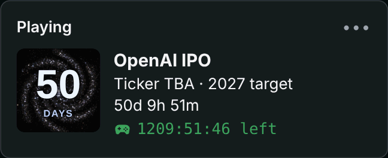
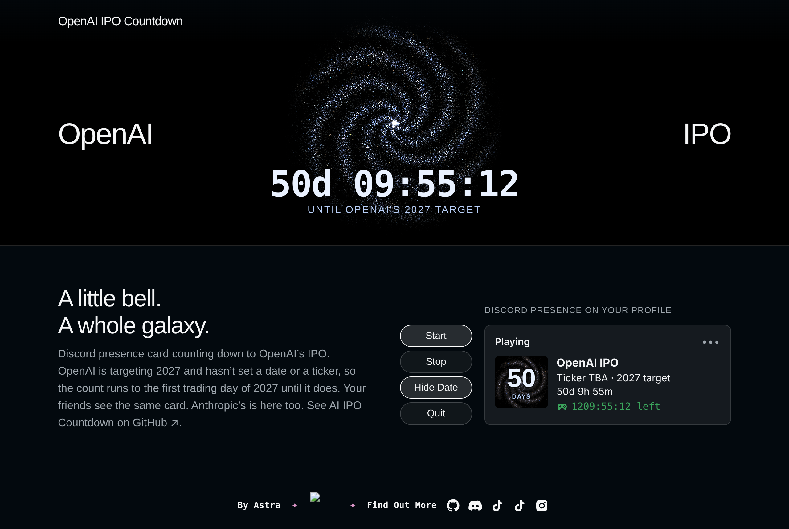
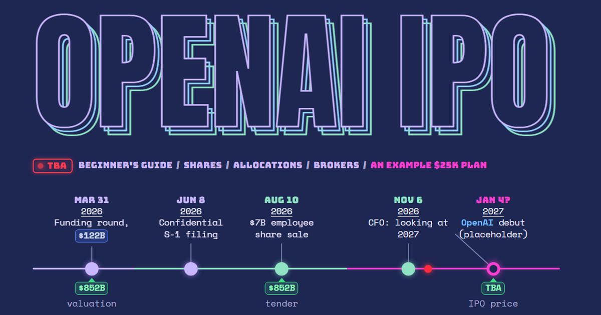

# OpenAI IPO Countdown

*By Astra.* Count down to OpenAI's IPO on your Discord profile. A free Windows app.

<b><a href="https://github.com/findastra/ai-ipo-countdown/raw/main/downloads/openai-ipo-countdown.zip">⬇ Download for Windows</a></b>

**Needs:** Windows, [Node.js 24 or later](https://nodejs.org/en/download) and the Discord desktop app with activity
sharing on.

## The App

A small program on your PC. Its page opens in your browser and shows a live preview of your card.

## Getting Started

1. Install [Node.js 24 or later](https://nodejs.org/en/download) if needed.
2. Extract the download and double-click **Start OpenAI IPO Countdown.cmd**.
3. Keep Discord desktop open with activity sharing on, and click **Start**.
4. Optional: double-click **Enable Automatic Startup.cmd** to start it with Windows.

In the middle of the galaxy, one kind of time at a time: days, then hours, minutes and the last minute's seconds. Under
the title, the time left and Discord's own live timer to the opening bell.

What every button does, and the quirks:
[ai-ipo-countdown, Buttons & Instructions](https://github.com/findastra/ai-ipo-countdown#buttons--instructions).

## The Date

**OpenAI has not set one.** As of November 15, 2026, it is targeting a listing in **2027** (its finance chief, to staff
on August 19 and to CNBC on November 6), with no exchange or ticker announced. Until there is a date, the count runs to
the first trading day of 2027, **Monday, January 4**, at the 9:30am opening bell in New York, and the card says
**Ticker TBA · 2027 target**. When OpenAI announces it, the app's settings take the real date, ticker and exchange
([how](https://github.com/findastra/ai-ipo-countdown/blob/main/openai-ipo-countdown/README.md#the-date)).

## The Field Guide

Astra's beginner's guide to the OpenAI IPO: what an IPO is, how the lottery works, the brokers, where OpenAI's IPO
stands, an example $25K plan and the next steps.

- [Read the guide online](https://findastra.github.io/openai-ipo/)
- [Download the one-page PDF](guide/OpenAI_IPO_Field_Guide.pdf)

Not financial advice. OpenAI has not set a date, ticker or price; the guide's prices are examples until the official
prospectus.

## Developer Notes

1. **Where the code is:** the app is built and kept in
   [findastra/ai-ipo-countdown](https://github.com/findastra/ai-ipo-countdown/tree/main/openai-ipo-countdown),
   together with Anthropic IPO Countdown. Report problems and send changes there.

## Official Artwork

The official blue six-arm galaxy from OpenAI Discord Presence uses individually moving stars, a white center and black
outer edges, with the count drawn over its core. Approved by Astra on October 30, 2026.
[Artwork and animation source](https://github.com/findastra/ai-discord-presence/blob/main/docs/official-galaxy-artwork-20261030.md).

## Credits

1. Built with Claude Opus 5.5, from 2026-11-15, together with the count pictures and this page.
2. Full list: the "Built with" lines in
   [ai-ipo-countdown's AGENTS.md](https://github.com/findastra/ai-ipo-countdown/blob/main/AGENTS.md).

## License

MIT, see [LICENSE](LICENSE).

Anthropic, OpenAI, Nasdaq and Discord are trademarks of their owners. This is an independent project, not made,
endorsed or sponsored by them, and not financial advice; their names appear only to say what is being counted down to.
